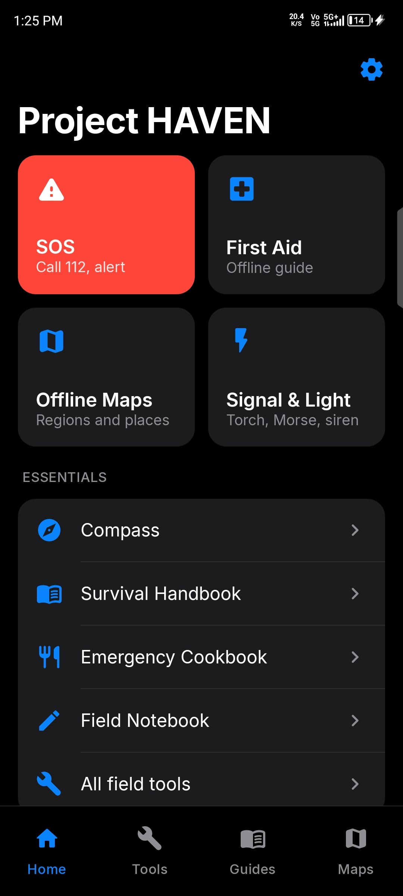
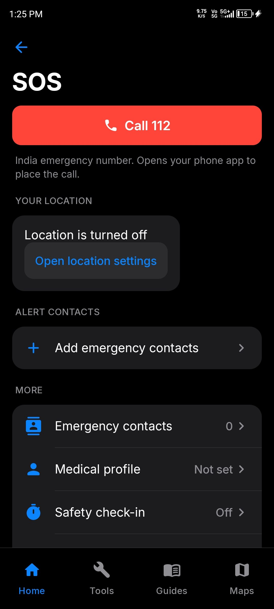
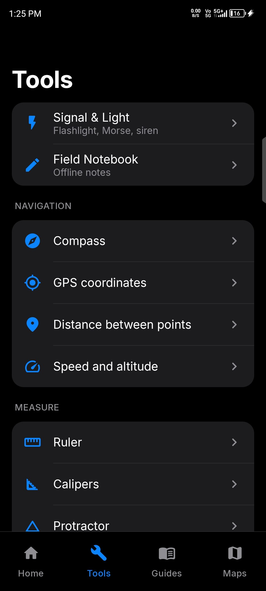
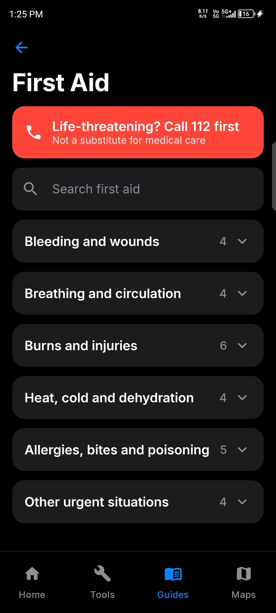
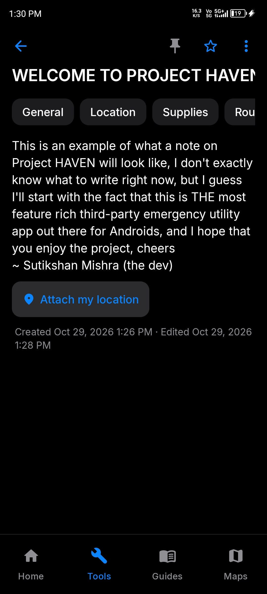

# Project HAVEN

> **Current release:** v1.0.0 · Initial public release
> 
<p align="center">
  <strong>India's emergency utility toolkit</strong><br>
  <em>Essential tools for when you need them most.</em>
</p>

<p align="center">
  An offline-first emergency and survival toolkit for Android, bringing SOS shortcuts, first aid, survival guidance, signalling tools, field instruments, a private notebook, and offline maps together in one app.
</p>

<p align="center">
  <strong>Developed by Sutikshan Mishra</strong>
</p>

> [!IMPORTANT]
> HAVEN is an independent project. It is **not affiliated with or endorsed by the Government of India**, and it does not replace emergency services or professional medical care. In an emergency in India, call **112** when a working phone network is available.

---

## Screenshots

<p align="center">
  
  
</p>
<p align="center">
  
  
</p>
<p align="center">
  
</p>

## Contents

- [Why HAVEN?](#why-haven)
- [Features](#features)
- [Requirements](#requirements)
- [Build from source](#build-from-source)
- [Install a debug build](#install-a-debug-build)
- [Testing](#testing)
- [Continuous integration](#continuous-integration)
- [Offline maps and routing](#offline-maps-and-routing)
- [Permissions and privacy](#permissions-and-privacy)
- [Offline capabilities and limitations](#offline-capabilities-and-limitations)
- [Project structure](#project-structure)
- [Licensing and attribution](#licensing-and-attribution)
- [Known limitations and future work](#known-limitations-and-future-work)

## Why HAVEN?

In an emergency, useful information and practical tools should be easy to find—even when mobile data is unavailable. HAVEN brings a range of emergency, preparedness, and field utilities into one Android app, with offline use at the centre of its design.

HAVEN includes offline guides and tools alongside features that depend on device hardware, installed map packs, or a working mobile network. Where a capability is unavailable, the app should make that limitation clear rather than imply that it works.

## Features

| Feature | What it includes | Offline availability |
|---|---|---|
| **SOS** | Call 112 through the system dialler; view live coordinates and accuracy; copy or share coordinates; prepare an SMS for emergency contacts to review before sending | Tools work offline where possible; calls and SMS require a SIM and network |
| **Emergency contacts** | Choose contacts using Android's contact picker or enter them manually; set a primary contact | Yes |
| **Medical profile** | Optional medical information, with every field optional; stored on-device and deletable at any time | Yes |
| **Safety check-in** | A timer that alerts you if you do not check in; offers to prepare messages but never sends them automatically; can re-arm after a reboot | Yes, subject to Android scheduling and battery restrictions |
| **Signal & Light** | Flashlight; Morse code using flash, sound, or screen; adjustable speed and gaps; SOS prosign; preview mode; siren; full-screen light | Yes, subject to available hardware |
| **First Aid** | 27 searchable articles across 6 categories, with step-by-step guidance, warnings, signs to watch for, and sources | Yes |
| **Survival Handbook** | 30 articles covering water, shelter and weather, navigation and signalling, supplies, personal safety, and preparedness checklists | Yes |
| **Emergency Cookbook** | 17 recipes using Indian pantry staples; filters for no cooking, limited water, limited fuel, and vegetarian food; food-safety guidance; ration and water planner | Yes |
| **Field tools** | Compass (magnetic and true north); GPS coordinates in decimal and DMS formats; distance and bearing; speed and altitude; calibratable ruler and calipers; protractor; spirit level; unit converter; calculator; battery information | Yes, with relevant sensors or location hardware |
| **Field Notebook** | Autosaving notes; search, pinning, favourites, tags, sorting, location attachment, sharing, and JSON import/export with duplicate protection | Yes |
| **Offline maps** | MapLibre rendering of installed PMTiles packs; place search and emergency points of interest when included in a pack; resumable downloads with verification before installation | After map packs are downloaded and installed |
| **Settings** | Dark, light, and system themes; permissions overview; storage and safe cleanup; privacy information; about and licence details | Yes |

### Not included in V1

- Offline turn-by-turn routing
- On-device AI question answering
- Camera-based Morse decoding
- Bluetooth peer messaging

These are not current V1 capabilities. See [Known limitations and future work](#known-limitations-and-future-work).

## Requirements

- **Android 8.0 (API 26)** or newer.
- Targets **Android 16 (API 36)**.
- **JDK 17 or newer**; JDK 21 is recommended.
- Android SDK with **platform 36** for building.
- Android Studio with a version compatible with the project's Android Gradle Plugin (AGP 9.4).

Flash, GPS, compass, accelerometer, and barometer hardware are optional. Tools that need unavailable hardware should show an unavailable state instead of silently implying that the feature is working.

## Build from source

### 1. Clone the repository

Replace `<repository-url>` with the URL of the public HAVEN repository.

```bash
git clone <repository-url> ProjectHAVEN
cd ProjectHAVEN
```

### 2. Configure the Android SDK

Open the project in Android Studio and allow it to configure the local SDK path. If building from the command line, create `local.properties` with the path to your Android SDK:

```properties
sdk.dir=/path/to/your/Android/Sdk
```

Do not commit machine-specific `local.properties` files.

### 3. Build the debug APK

On Linux or macOS:

```bash
./gradlew assembleDebug
```

On Windows:

```bat
gradlew.bat assembleDebug
```

The debug APK is generated at:

```text
app/build/outputs/apk/debug/app-debug.apk
```

### Optional build properties

These properties can be placed in `~/.gradle/gradle.properties` or supplied with Gradle's `-P` option.

| Property | Purpose |
|---|---|
| `haven.repositoryUrl` | Displays a **Source code** link in About. Hidden when empty. |
| `haven.mapCatalogUrl` | Sets the default map catalogue URL (for example, an HTTPS URL ending in `catalog.json`). Users can also set a catalogue in Map downloads. |

## Install a debug build

With a connected Android device and ADB installed:

```bash
adb install -r app/build/outputs/apk/debug/app-debug.apk
```

Alternatively, transfer the APK to your device and open it. Android may ask you to allow installation from that source.

> [!NOTE]
> A debug APK is signed with the Android debug key. It is intended for development and testing, **not as a production release**.

## Testing

Run JVM unit tests:

```bash
./gradlew testDebugUnitTest
```

Run instrumented Android tests on a connected device or emulator:

```bash
./gradlew connectedDebugAndroidTest
```

Validate the bundled guide content:

```bash
python3 tools/content/build_guides.py --check
```

The unit-test suite covers Morse encoding and timing, unit conversion, calculator logic, geographic distance and bearing, speed estimation, note editing and search, sorting and import/export, guide parsing and search against bundled files, recipe filters, checklist and theme persistence, map manifest validation, checksums, the download state machine, map-pack installation and rollback, and map-style generation.

## Continuous integration

The GitHub Actions workflow at `.github/workflows/android.yml` runs on pushes and pull requests to `main`, as well as manual dispatch. It validates the Gradle wrapper, configures JDK 21 and Gradle caching, checks bundled content, runs `testDebugUnitTest`, builds the debug APK, and uploads an artifact named `project-haven-debug-apk`.

To retrieve the APK, open the relevant workflow run under **Actions** and look in its **Artifacts** section. Test reports are retained for each run, and build reports are retained on failure.

If the repository uses a default branch other than `main`, update the branch filters in the workflow.

The `.github/workflows/instrumented.yml` workflow runs instrumented tests on an emulator when triggered manually. It uses a third-party action; review and pin that action before relying on the workflow.

No signing keys or repository secrets are required by these workflows.

## Offline maps and routing

**Displaying a map is not the same as providing navigation.** HAVEN can render vector maps from PMTiles packs stored on the device. Offline turn-by-turn navigation requires a separate routing graph and routing engine, which are not included in V1.

Until routing is implemented for a region, HAVEN displays **"Offline routing not available for this region"** rather than drawing or suggesting an unverified route. The integration plan is documented in [`docs/ROUTING.md`](docs/ROUTING.md).

### Map-pack components

| Component | File | What it enables |
|---|---|---|
| Vector tiles | `tiles.pmtiles` (OpenMapTiles schema) | Map display |
| Places | `places.json` | Offline place search |
| Emergency points of interest | `poi.json` | Nearby hospitals, clinics, pharmacies, police stations, and fire stations when included in the pack |
| Routing graph | Engine-specific | Not used in V1 |

### Creating and hosting map packs

HAVEN does not assume that map packs are hosted at a particular public URL. Packs are built from OpenStreetMap data using the pipeline in `tools/mappack/` (Planetiler and pyosmium). See [`docs/MAP_PACKS.md`](docs/MAP_PACKS.md) for details.

A generated pack catalogue (`catalog.json`) can be published to a static HTTPS host, including GitHub Releases. Set the catalogue URL at build time or in the app's Map downloads screen.

Downloads can resume after interruption. Files are checked for size, format, and SHA-256 before installation; an existing working pack is not replaced until the new pack passes verification.

### Starter map coverage

The pipeline defines an India overview pack and a Lucknow–Unnao–Kanpur pack. `tools/mappack/bundle_starter.py` can bundle them inside the APK.

These packs are **not included in this repository** because they must be generated from current OpenStreetMap data. Refer to the map-pack documentation for the reasoning and workflow.

Map labels require glyph files generated by `tools/mappack/build_glyphs.sh`. Without those files, maps may render without text.

## Permissions and privacy

HAVEN is designed to keep personal information on the device and to avoid requesting broad permissions when a narrower Android system interface will do.

| Permission or capability | Purpose | When it is requested or used |
|---|---|---|
| Location | Coordinates, SOS information, true north, speed, and maps | When you open a location-based feature |
| Notifications | Safety check-in alerts | When you start a check-in on Android 13 or newer |
| Alarms and reminders | More precise check-in alerts | Optional, from the check-in screen |
| Internet | Map catalogue access and map-pack downloads initiated by the user | No runtime permission prompt |
| Boot completed | Re-arming an active check-in after a restart | No runtime permission prompt |

HAVEN does not request contacts, camera, phone, or SMS permissions. Contacts can be selected one at a time through Android's contact picker. The flashlight uses the camera service without requesting camera access. Calls and messages open system apps so that **you can review and confirm the action**.

There is no account, analytics, or tracking. Notes, contacts, and the medical profile are stored in app-private storage and excluded from cloud backup and device transfer. HAVEN does not add its own encryption layer; stored data relies on Android's device encryption and your screen lock. Location is accessed only while a location screen is visible.

## Offline capabilities and limitations

Offline-first does not mean every action works without a network, nor does it guarantee that every device will behave identically. Keep these limitations in mind:

- **Calls and SMS:** Require a working SIM and mobile network. Opening the dialler or messaging app does not place a call or send a message automatically.
- **GPS:** Needs a usable satellite signal and a view of the sky. The first location fix can take longer without mobile data.
- **Safety check-in:** Android battery optimisation can delay alerts. Precise timing requires the optional **Alarms and reminders** permission where supported.
- **Ruler and calipers:** Measurements are approximate until calibrated against a known object.
- **Medical guidance:** The bundled first-aid guides are based on publicly available medical knowledge, have NOT been reviewed by a medical professional and do NOT aim to replace medical help.
- **Maps:** Offline maps work only when suitable packs have been generated, downloaded, and installed. Turn-by-turn offline routing is not available in V1.

Do not rely on HAVEN as your only source of emergency assistance, medical advice, or navigation.

## Project structure

```text
app/src/main/java/app/projecthaven/
  domain/       Pure Kotlin logic (Morse, units, calculator, geo, notes, guides, maps, SOS)
  data/         Android-backed repositories (DataStore, Room, sensors, location, torch, audio,
                check-in alarms, map packs, and downloads)
  ui/           Compose theme, components, navigation, and screens

app/src/main/assets/guides/   Bundled guide JSON generated by tools/content
tools/content/                Guide source text, builder, and validator
tools/mappack/                Map-pack generation pipeline
docs/                         Toolchain, maps, routing, and content-review documentation
```

## Licensing and attribution

- **Source code:** [GPL-3.0-or-later](LICENSE). See [`NOTICE`](NOTICE).
- **Third-party libraries, fonts, and data:** Retain their own licences. See [`THIRD_PARTY_NOTICES.md`](THIRD_PARTY_NOTICES.md).
- **Map data:** © OpenStreetMap contributors, available under the Open Database License (ODbL).
- **Map tiles:** Use the OpenMapTiles schema; see the applicable OpenMapTiles attribution and licence terms.
- **Project name and logo:** The name **Project HAVEN** and its logo are not covered by the GPL. See [`BRANDING.md`](BRANDING.md).

## Known limitations and future work

- Offline turn-by-turn routing, camera-based Morse decoding, Bluetooth peer messaging, and on-device question answering are planned for a future version; they are not V1 features.
- Map packs and label glyphs must be generated and hosted before those maps are available to users.
- The app's bundled content is currently English-only.
- Check the repository's latest GitHub Actions runs for build and implementation status.

---

<p align="center">
  <strong>Project HAVEN</strong><br>
  Built to keep essential tools close at hand.
</p>
